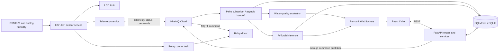

# Current architecture

Rebuild context (2026-10-16): this document maps the existing code. It is not an approved replacement design; see [decision 0002](../decisions/0002-rebuild-direction.md).

Source-verified: 2026-10-15, Git `785e08b` plus the existing cleanup. This is a description of source, not a hardware or deployment acceptance report. Product targets belong to the [PRD](../PRD.md).

## Modules and entry points

| Module | Existing responsibility | Evidence |
|---|---|---|
| Firmware orchestration | Starts four pinned tasks; sensor/control/telemetry tasks register with the watchdog. Display reads local state. | [main.c](../../firmware/main/main.c) |
| Sensor service and drivers | Managed OneWire/DS18B20 temperature conversion; calibrated ADC millivolts; project-specific turbidity conversion; EMA filtering; local validity flags and staleness. | [sensor service](../../firmware/components/sensor_service/src/sensor_service.c), [DS18B20](../../firmware/components/ds18b20_sensor/src/ds18b20_sensor.c), [ADC](../../firmware/components/turbidity_sensor/src/turbidity_sensor.c) |
| Wi-Fi | BLE provisioning, MAC-derived name/PoP, NVS provisioned flag, Wi-Fi reconnect timer, credential-reset function. | [wifi_manager.c](../../firmware/components/wifi_manager/src/wifi_manager.c) |
| Device MQTT | Generates MAC-derived ID, JSON, online/LWT, command subscription, TLS configuration, in-memory ring buffer. | [telemetry_service.c](../../firmware/components/telemetry_service/src/telemetry_service.c) |
| API lifecycle | Registers models and routers, creates tables, synchronously loads ML resources, starts/stops subscriber. | [main.py](../../backend/main.py) |
| Persistence | `TankProfile`, `Device`, `WaterLog`, `Prediction`; a session per request/ingestion operation. Default SQLite location is resolved from the database module. | [db.py](../../backend/database/db.py), [models](../../backend/models/) |
| Domain services | CRUD, derived tank capacity, evaluated readings, summaries, prediction persistence. | [services](../../backend/services/) |
| Browser | Component-local React state, fetch wrapper, REST initial loads, selected per-tank WebSockets, Recharts, Tailwind CSS. | [App.jsx](../../frontend/src/App.jsx), [client.js](../../frontend/src/api/client.js), [Vite config](../../frontend/vite.config.js) |

Firmware loop-delay constants are 2000 ms for sensing, 5000 ms for control and telemetry, and 1000 ms for display. The DS18B20 driver also delays for conversion; these are not guaranteed wall-clock sample periods. [Q01](../research/open-questions.md#q01-time-and-forecast-contract) tracks reconciliation with product/model timing.

## Existing telemetry contract

Prefix defaults to `bangusbuhai`. Device ID is `BB-` plus six MAC bytes in hexadecimal. Device topics end in `/telemetry`, `/status`, and `/cmd` under `{prefix}/devices/{device_id}`.

Telemetry currently includes `device_id`, `tank_id`, `seq`, `fw_version`, `uptime_s`, a `readings` object (`temperature`, `turbidity`, `ph`, `ph_source`, `relay_on`), and system heap/RSSI/reconnect fields. See [the JSON builder](../../firmware/components/telemetry_service/src/telemetry_service.c) and [backend parser](../../backend/services/mqtt_subscriber.py).

It does not carry a capture timestamp or the sensor service's validity flags. Queued readings contain values/provenance/relay state; sequence and uptime are generated when JSON is built. The backend assigns server receipt time to `recorded_at` and does not persist sequence/uptime. This describes a limitation, not a proposed final contract.

Command JSON uses `relay` and boolean `state`; firmware currently recognizes the legacy name `heater`. That string does not establish what is physically connected. The actual prototype relay is unloaded.

## Core feature: reading to browser

1. `sensor_task` calls the sensor service and retains the filtered local reading. Firmware sends default pH with its provenance.
2. `telemetry_task` passes values and driver relay state to MQTT; disconnected messages enter the in-memory queue.
3. Paho callbacks schedule `handle_telemetry` onto the FastAPI asyncio loop. It upserts a device, creates a water log, commits, and evaluates status.
4. The subscriber broadcasts `new_reading`. It also attempts a prediction after each accepted MQTT reading; fewer than 48 logs produces an HTTP exception that is suppressed in this path.
5. Prediction service orders the latest 48 logs chronologically, invokes the model/scaler, stores a row, and broadcasts `new_prediction`.
6. Tank detail initially fetches summary, logs, devices, and latest prediction; its WebSocket updates the reading/chart/relay/prediction state. Dashboard subscribes only to its first selected tank. Other pages load REST snapshots.

Manual REST log creation returns evaluated data but does not call the MQTT broadcast/prediction path. Device status broadcast wiring is incomplete; see [S04](../status/implementation.md#s04-data-and-ingestion).

## REST and WebSocket surface

Paths include prefixes applied in [main.py](../../backend/main.py). This table describes registered source routes; it is not a runtime test result.

| Resource | Routes | Source |
|---|---|---|
| Metadata/health | `GET /`, `GET /health` | [main.py](../../backend/main.py) |
| Tanks | `POST/GET /tanks/`, `GET/PUT/DELETE /tanks/{tank_id}`, `GET /tanks/{tank_id}/summary` | [tank_routes.py](../../backend/routes/tank_routes.py) |
| Water logs | `GET /tanks/logs/all`, `POST/GET /tanks/{tank_id}/logs`, `GET/PUT/DELETE /tanks/{tank_id}/logs/{log_id}` | [waterlog_routes.py](../../backend/routes/waterlog_routes.py) |
| Predictions | `POST/GET /tanks/{tank_id}/predictions/`, `GET /tanks/{tank_id}/predictions/latest` | [prediction_routes.py](../../backend/routes/prediction_routes.py) |
| Devices | `GET /devices/`, `GET /devices/{device_id}`, `POST /devices/{device_id}/command` | [device_routes.py](../../backend/routes/device_routes.py) |
| Live updates | `/ws/tanks/{tank_id}`; `new_reading`, `new_prediction`, `device_status` messages | [websocket_routes.py](../../backend/routes/websocket_routes.py), [manager](../../backend/services/websocket_manager.py) |

Device API paths expect the string `Device.device_id`, not its numeric row ID. User/feeding routes, login, and device-claiming endpoints are absent. `/health` returns a fixed application response rather than checking broker/model/database readiness.

## Models, ML, and conventions

`Device.tank_id` associates a device with a tank; `TankProfile` has no `device_id` or `owner_id`. Water logs have tank/device foreign-key declarations; declaration alone does not demonstrate SQLite enforcement or migration safety. Predictions persist flattened horizon fields, `predicted_from`, creation time, and a heuristic confidence score.

The [model class](../../backend/ml/models/bangus_lstm.py) is LSTM(3,128), dropout, LSTM(128,64), dropout, Linear(64,32), ReLU, Linear(32,3). [Inference](../../backend/ml/inference.py) scales 48 rows in temperature/pH/turbidity order and recursively appends model output four times. [Metadata](../../backend/ml/models/bangus_buhai_metadata.json) records horizon 12; code does not use metadata to enforce time semantics. Training and model evaluation are not included here.

Python uses snake_case modules, SQLModel schemas, injected sessions, and service-level HTTP exceptions. React uses PascalCase components/pages with local hooks; the API wrapper throws `ApiError`. The backend mixes synchronous database/model operations with asynchronous transport. Git titles are informal and often cover multiple layers; no consistent PR workflow is established by the inspected history.
