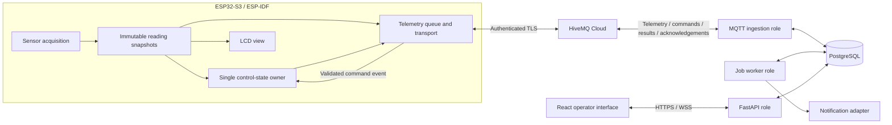

# Replacement architecture proposal

Date: 2026-10-16. Status: **proposed; not implemented or accepted**. PRD: R01-R21, with R15/R22 hardware expansion outside the first release. Evidence: Git `8ec0183` plus earlier uncommitted cleanup; targeted source review, no runtime/build/hardware tests. The [PRD](../PRD.md) owns requirements. The [existing architecture](../reference/architecture.md) remains the dated source map.

## Scope and approach

T11 update (2026-10-21): accounts and registry API slices are implemented and
verified within their task limits. [Decision 0008](../decisions/0008-self-service-device-claiming.md)
records trusted preparation, self-service claiming and separately acknowledged
configuration. [T11](../status/tasks/T11.md) owns the 76-test/local migration
evidence; actual firmware/client claiming is still a separate integration step.
The broader process/MQTT/worker architecture below remains proposed.

T09 update (2026-10-21): the owner accepted hatchery ownership with scoped account
roles, several devices per tank and one active binding per device. The scoped
[database decision](../decisions/0006-database-ownership-and-bindings.md) and
[T09 record](../status/tasks/T09.md) supersede the pending ownership interpretation
below. Other proposed process/API/transport boundaries remain provisional.

Keep the owner-confirmed ESP-IDF/current-hardware scope, unloaded relay, one hatchery/larvae deployment and production-software goal from [decision 0003](../decisions/0003-first-production-software-release.md). Farm size/connectivity remain unknown, not guessed architecture inputs. Retain FastAPI, React/Vite and PyTorch from the baseline, and PostgreSQL from R18; exact dependency versions and compatibility need verification before implementation.

Propose a modular backend with one codebase and three process roles using one application image: `api`, `ingest`, and `worker`. The API serves operators; ingestion handles MQTT; workers handle durable jobs including inference and notifications. This isolates blocking inference from ingestion and HTTP work without requiring a separate microservice codebase or Redis initially. Qualification must test the deployed process/connection configuration, not promise unlimited scale or high availability.

## Component map

Broker permissions and enrollment are required trust boundaries. A MAC-derived ID is an identifier, not a credential. The backend cannot infer a publisher's certificate identity from ordinary subscribed payloads: broker ACLs must bind authenticated devices to their own topics, and ingestion must check topic/payload/registry agreement. The shared [contract proposal](device-and-api-contracts.md) defines identity, capture time, provenance and command semantics.

## Firmware responsibilities

| Owner | Proposed responsibility | Isolation/failure behavior |
|---|---|---|
| Acquisition task/service | Read physical temperature/turbidity, filter and validate; produce capture time, monotonic uptime and provenance | Bounded driver operations. Failed/default values never silently become valid measurements. No network waits while holding sensor locks. |
| Control task/service | Sole runtime owner of relay GPIO, mode, desired/applied state and reason | MQTT callbacks enqueue commands; they never directly write GPIO. Startup OFF and stale-temperature OFF override commands. Current unloaded scope remains explicit. Manual/automatic arbitration must be settled before control implementation. |
| Telemetry task/service | Select immutable snapshots at the PRD transmission schedule, retain event identity through retries, process durable-ingest acknowledgements | Bounded queue and retry work; no blocking of sensing/control. Report drops and unsynchronized time. Reconnect cannot rewrite historical capture time or sequence. |
| Display task/service | Render immutable reading/control snapshots and quality indicators | Display failures cannot block sensing, force control, or change authoritative state. |
| Provisioning/recovery services | Wi-Fi/BLE lifecycle, credential lifecycle, diagnostics and future update verification | Bounded backoff; independent local operation; preserve useful reset/error/heap evidence without logging secrets. |

Use queues to transfer owned data and short protected snapshots for readers. ESP-IDF task priorities, stack/queue sizes and core affinity need measured justification rather than copying old values. Keep local capture cadence, five-minute R06 transmission intent and model grid separate; Q01 still resolves model timing. Existing sensor/header comments about extra predicted parameters are not evidence: R11 limits forecasts to temperature/pH/turbidity.

The source target is ESP32-S3; the recorded IDF baseline is 6.0.2. Actual wiring, electrical limits, calibration, free console transport, flash capacity and component compatibility remain Q06. No pins, partition layout, security fuses or new hardware behavior are selected here. For OTA, use the selected version's [confirmation/rollback workflow](https://docs.espressif.com/projects/esp-idf/en/v6.0.2/esp32s3/api-reference/system/ota.html); allocating slots alone is insufficient evidence of recovery.

## Backend modules and transaction boundaries

| Module | Responsibility | Key rule |
|---|---|---|
| Identity/access | Owner-provisioned Supabase email/password identities, one operator role, backend browser sessions and hatchery membership | Accepted in decision 0007; T10 supplies reusable access dependencies, with local tests and owner-run live-provider smoke PASS. Every future REST, live-stream, export and command path must check authenticated hatchery access. T10 records evidence and deployment limits. |
| Tank/device registry | Tank CRUD, verified device enrollment, ownership and versioned tank bindings | No creation/claiming/reassignment solely from device-supplied tank IDs. Preserve association history. |
| Ingestion/readings | Parse the versioned contract, validate, deduplicate, persist and expose ordered history/manual records | A transaction commits reading plus downstream event/job intent before sending an application acknowledgement. |
| Commands | Validate actor/target, persist intent, publish with expiry, track device results | HTTP acceptance, broker publication, device application and observed GPIO state are distinct. |
| Quality/alerts | Single quality policy, alert lifecycle, acknowledgement and notification intent | The UI consumes server evaluations. Keep quality, freshness and provenance distinct; hatchery suitability remains unverified until Q02 is resolved. |
| Forecasting | Eligible chronological windows, model/scaler/version provenance, target timestamps and evaluation | Disabled/unavailable is explicit until timing/artifact validation supports the claimed horizons. Default pH remains labeled and cannot establish measured-pH accuracy. |
| Operations/jobs | Migrations, leases/retries, bounded logs/metrics, readiness, recovery and notification adapter | Failures are observable and retryable without pretending external effects are exactly once. |

Proposed later data groups include reading corrections, command intents/results, forecasts, policy versions/alerts, audit records and transactional outbox/jobs. T09 already supplies hatchery ownership, tanks/devices, binding history and immutable events (decision 0006). T10 adds provider identity mapping, operator membership, persistent sessions and shared login throttling (decision 0007). R16 now records the accepted hatchery ownership and equal operator access; the former three-role proposal is superseded. Later data groups remain proposals until their own tasks.

Use foreign keys, uniqueness and migrations rather than startup `create_all` as a production upgrade strategy. Request, ingest transaction and job each own their database session; do not pass a shared mutable session between tasks/threads. [SQLAlchemy documents these session concurrency limits](https://docs.sqlalchemy.org/en/20/orm/session_basics.html#is-the-session-thread-safe-is-asyncsession-safe-to-share-in-concurrent-tasks).

The ingest role owns the MQTT connection and command/outbox publisher with stable lifecycle/reconnect handling. Workers claim jobs using durable leases; retries use semantic idempotency keys. Database failure means no success acknowledgement; a command result or notification cannot disappear solely because the API process restarted. Job scheduling, fairness, retry/expiry budgets and shutdown behavior need concrete tests.

## Live updates and operator workflow

Proposed primary flow: authenticate -> open an authorized tank -> inspect latest readings plus provenance/freshness -> inspect alerts/forecasts/history -> acknowledge an alert or submit a permitted manual record/relay demonstration -> review the recorded result. Actual warning/action policy still needs domain evidence; no physical automated-control claim is introduced.

Persist event/outbox records with an opaque resume cursor. API processes read committed events and deliver them to authorized local sockets. A notification wakeup may reduce delay, but durable rows/cursors provide recovery; reconnect uses cursor catch-up or a fresh authorized snapshot if retention expired. Socket state alone is not the event store: FastAPI's [in-memory example is limited to one process](https://fastapi.tiangolo.com/advanced/websockets/). Proposed polling interval/retention/throughput budgets must be qualified before rollout.

Never optimistically show a relay command as applied. Lost browser connectivity, missing samples and unavailable forecasts are visible states. Backend device identity is the canonical external `BB-...` ID; database row IDs must not be substituted into device paths.

## Deployment, security and recovery

- Environment-specific configuration; HTTPS/WSS and least-privilege broker/database identities. Validate JWT issuer/audience/expiry and session revocation behavior, role enforcement, stream authorization and origin/CSRF behavior as appropriate to the selected authentication integration. No browser-to-broker admin credentials.
- One image with separate API/ingestion/worker entry points, versioned migrations, a static frontend build and PostgreSQL backups. Run migrations as an explicit deployment step; test restore and application rollback without dropping current data.
- Separate liveness from readiness; expose relevant database/broker/job/model status without leaking secrets. Track ingest rejection/duplicate/lag counts, queue drops, job failures, command outcomes, reconnects and firmware reset/heap diagnostics.
- Validate cold boot without internet, reconnect/backfill, database/broker outage, client reconnect, expired commands, session revocation and notification failures. Report the test environment and measured supported envelope.

Vendor evidence checked 2026-10-16: HiveMQ's [plan comparison](https://docs.hivemq.com/hivemq-platform/connect/access-management-options-per-cloud-plan.html) lists X.509/mTLS as unavailable on Serverless and supported on Starter/Enterprise. Starter supports one active authentication method per cluster. Actual account plan/settings are unknown; R17 therefore remains a release constraint, not a verified capability. No subscription change or requirement relaxation is authorized by this proposal.

## Reuse and transition

| Existing source | Candidate disposition | Required verification |
|---|---|---|
| [Sensor drivers/service](../../firmware/components/sensor_service/), [relay driver](../../firmware/components/relay_driver/), [Wi-Fi manager](../../firmware/components/wifi_manager/) | Evaluate low-level reuse; replace conflicting task/state ownership | Wiring/calibration, error/lifecycle handling, clean version-compatible build and device fault tests |
| [Firmware orchestration](../../firmware/main/main.c), [telemetry](../../firmware/components/telemetry_service/src/telemetry_service.c) | Rework concurrency and versioned envelopes | Existing callbacks write relay directly; old queued samples lack immutable capture metadata |
| [Backend ingestion](../../backend/services/mqtt_subscriber.py), [models](../../backend/models/), [device route](../../backend/routes/device_routes.py) | Reuse domain knowledge; rebuild trust/transaction/contract boundaries | Existing permissive parsing, device rebinding, identity mismatch, TLS-command and lifecycle issues |
| [Browser API](../../frontend/src/api/client.js), [pages](../../frontend/src/pages/) | Evaluate reusable presentation; rebuild access/data-state integration | Unified server policy, canonical identifiers, resync, accessible/responsive behavior |
| [Inference/artifacts](../../backend/ml/) | Preserve; production reuse unapproved | Q01/Q03 training timebase, evaluation and compatible artifact evidence |

Proposed isolation for future authorized implementation: a repository-local `rebuild/` area containing `firmware/`, `backend/`, `frontend/`, `contracts/` and test/deployment configuration. This directory is not created by this documentation task. Keep current application/configuration/data untouched; use separate database, broker credentials/topic prefix and ports for the replacement. No automatic import or dual-write path; approve a mapped, rehearsed migration and rollback before switching environments. Cleanup deletions were subsequently committed as `a8cb626`; the proposal remains unimplemented. The [numbered roadmap](../roadmap.md) and [status](../status/rebuild.md) own future task sequencing and progress.

## Next bounded deliverable

Review this proposal with the [shared contracts](device-and-api-contracts.md). Develop missing authentication integration, ownership interpretation, executable schemas/fixtures, qualification budgets and concrete slice plan. The first implementation candidate remains authenticated owned-tank access plus validated reading history, with a parallel firmware snapshot/queue boundary once hardware context is verified. No implementation readiness is claimed while material slice dependencies remain unresolved.
